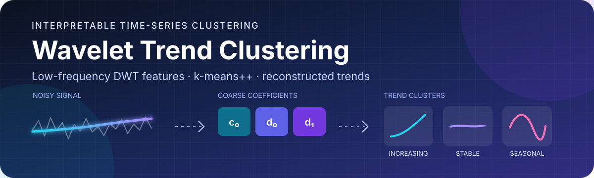
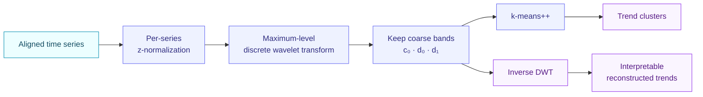
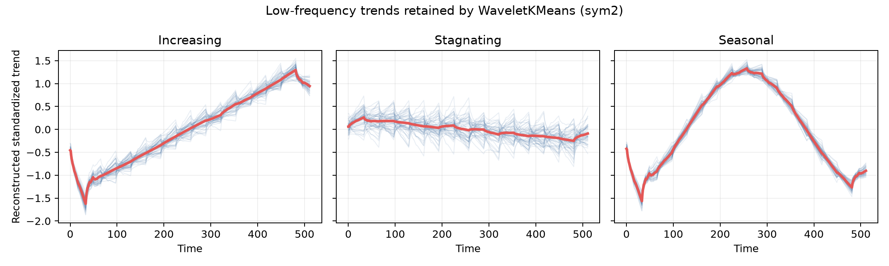

# Wavelet Trend Clustering

<p align="center">
  
</p>

<p align="center">
  <a href="https://github.com/redhamoulla/wavelet-trend-clustering/actions/workflows/ci.yml"></a>
  
  
</p>

An interpretable, scikit-learn-compatible implementation of the method from
Talbo et al., [*Wavelet-based clustering for time-series trend detection*](https://arxiv.org/abs/2011.12111).

The method clusters aligned time series by long-term behavior instead of raw
point-to-point noise. It z-normalizes each series, computes a discrete wavelet
transform, keeps only the coarsest `(c0, d0, d1)` coefficients, and applies
k-means++ in that compact feature space.

## How it works



## Installation

```bash
python -m pip install -e .
```

For the benchmark and development tools:

```bash
python -m pip install -e ".[dev]"
```

## Quick start

`X` must have shape `(n_series, n_timestamps)`. All series must be finite,
equal-length and aligned in time.

```python
from wavelet_clustering import WaveletKMeans

model = WaveletKMeans(
    n_clusters=3,
    wavelet="sym2",
    random_state=0,
)
labels = model.fit_predict(X)

# Low-dimensional (c0, d0, d1) representation
features = model.wavelet_features_

# Smooth standardized signals containing only the retained trend
trends = model.reconstruct_trends(X)

# Assign new, equally long and aligned time series
new_labels = model.predict(X_new)
```

To assess sensitivity to the mother wavelet:

```python
from wavelet_clustering import wavelet_consensus

result = wavelet_consensus(X, wavelets=("haar", "db2", "sym2", "coif1"))
agreement = result.agreement  # pairwise co-clustering frequency
```

## Reproduce the synthetic experiment

```bash
python examples/synthetic_benchmark.py --output-dir artifacts
```

The experiment creates increasing, stagnating and seasonal series with random
offsets, amplitudes, noise and high-frequency nuisance oscillations. It reports
the adjusted Rand index, silhouette score and dimensionality for raw k-means
and five wavelet variants, then saves a visualization of reconstructed trends.

Results with the fixed seed (`n=150`, 512 timestamps):

| Method | Features | Adjusted Rand index | Silhouette |
|---|---:|---:|---:|
| Raw standardized samples | 512 | 1.000 | 0.327 |
| Haar | 4 | 1.000 | 0.929 |
| Symlet 2 | 22 | 1.000 | 0.837 |
| Symlet 3 | 44 | 1.000 | 0.773 |

The benchmark is intentionally simple and auditable. The labels are recovered
by both approaches, while the wavelet representation uses 12-128 times fewer
features and produces substantially more separated clusters.

<p align="center">
  
</p>

<p align="center"><em>Symlet 2 reconstruction: individual retained trends in blue and the mean trend in red.</em></p>

## Why this implementation is faithful

- independent standard normalization of every series;
- maximum valid DWT decomposition level;
- zero-padding at boundaries;
- only `(c0, d0, d1)` retained by default;
- k-means with k-means++ initialization;
- regression tests for the paper's dimensionality calculation (including a
  documented 14-versus-8 inconsistency for Haar in Table I).

See [the method notes](docs/method.md) for notation, assumptions and the exact
mapping to PyWavelets.

## Development

```bash
pytest
ruff check .
python -m build
```

## Citation

If this package supports your work, cite the original article:

> V. Talbo, M. Haddab, D. Aubert, and R. Moulla (2020). Wavelet-based
> clustering for time-series trend detection. arXiv:2011.12111.

## License

BSD 3-Clause. See [LICENSE](LICENSE).
