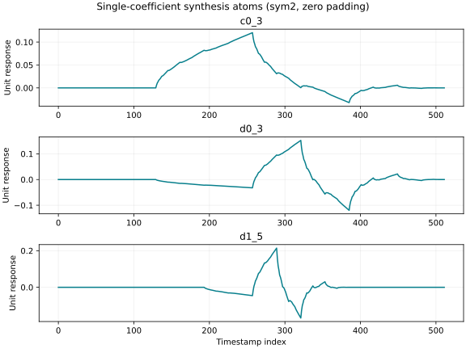
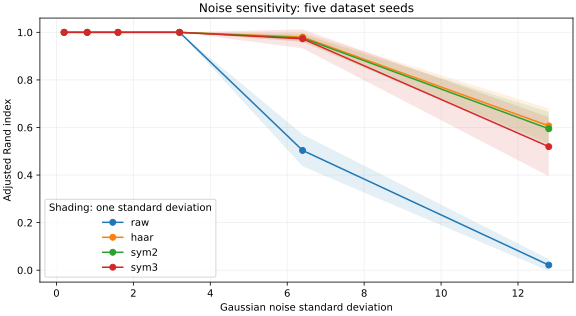
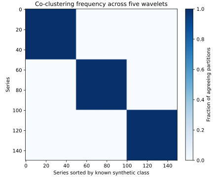

# Wavelet-Based Clustering for Time-Series Trend Detection

*A scientific companion to the Python implementation*

This manuscript develops the method implemented in
[`wavelet_clustering`](../src/wavelet_clustering): its mathematical formulation,
the meaning of the retained coefficients, reconstruction, numerical
experiments and limits. It accompanies the article by Talbo, Haddab, Aubert
and Moulla (2020), [arXiv:2011.12111](https://arxiv.org/abs/2011.12111).
The derivations below explain the current implementation; the controlled
experiments are generated by this repository.

## Contents

1. [Purpose and relation to the article](#1-purpose-and-relation-to-the-article)
2. [Normalization and the clustering problem](#2-normalization-and-the-clustering-problem)
3. [Discrete wavelet features](#3-discrete-wavelet-features)
4. [Clustering in coefficient space](#4-clustering-in-coefficient-space)
5. [Reconstruction and mathematical properties](#5-reconstruction-and-mathematical-properties)
6. [Interpretation and agreement across wavelets](#6-interpretation-and-agreement-across-wavelets)
7. [Reproducible experiments](#7-reproducible-experiments)
8. [API and practical use](#8-api-and-practical-use)
9. [References](#9-references)

## 1. Purpose and relation to the article

The goal is to group time series with similar evolution over a common
observation window. A raw Euclidean distance compares every sample. The
wavelet representation instead compares a small set of coefficients associated
with coarse temporal scales. This choice defines which differences matter:
short-scale variations can disappear from the representation.

The article applies this idea to 61 retail sales series, using normalization,
a maximum-level discrete wavelet transform, three retained bands and
k-means++. The retail data are not distributed in this repository. The public
examples therefore provide synthetic validation, not a reproduction of the
original business results.

Two source details require care. Section III uses 846 observations, whereas
the abstract and introduction say 864. The dimensionality audit here uses 846.
Table I gives 14 retained coefficients for a two-tap filter; the stated
maximum-level rule with zero extension yields 8 for Haar in this implementation.
The code follows the rule and records the discrepancy.

| Article concept | Implementation |
|---|---|
| Independent normalization of each series | `WaveletFeatureExtractor.normalize` |
| Maximum decomposition level | `pywt.dwt_max_level` |
| Zero extension at the ends | `mode="zero"` |
| Coarsest approximation and two detail bands | `n_detail_levels=2` |
| k-means++ followed by k-means | `WaveletKMeans` wrapping scikit-learn |
| Inspect retained temporal structure | `inverse_transform` and `reconstruct_trends` |
| Compare partitions across wavelets | `wavelet_consensus` |

The reproducible defaults `random_state=0` and `n_init=20` are package choices.
They make the numerical protocol explicit.

## 2. Normalization and the clustering problem

Let $`X\in\mathbb{R}^{n\times N}`$ contain one univariate series per row:
there are $`n`$ series, each with $`N`$ observations on the same time grid.
The implementation requires finite, equal-length input. It does not align
timestamps, fill gaps or resample automatically.

### 2.1 Row normalization

**(E1) Mean, population standard deviation and normalized samples.**

```math
\mu_i=\frac{1}{N}\sum_{t=0}^{N-1}x_{it},
\qquad
\sigma_i^2=\frac{1}{N}\sum_{t=0}^{N-1}(x_{it}-\mu_i)^2,
\qquad
z_{it}=\frac{x_{it}-\mu_i}{\sigma_i}.
```

For an exactly constant series, the code substitutes 1 for the zero
denominator, so every normalized sample is zero. A nonconstant normalized
row has mean zero and squared Euclidean norm $`N`$, up to rounding.
The standard deviation uses `ddof=0`.

This removes absolute level and positive amplitude as clustering criteria.
If two stores have the same normalized evolution but different revenue
levels, this representation deliberately treats them alike.

**(E2) Invariance to positive affine changes of an individual series.**

```math
\mathcal{Z}(a_i x_i+b_i\mathbf{1})=\mathcal{Z}(x_i),
\qquad a_i>0.
```

The equality follows because the mean becomes $`a_i\mu_i+b_i`$ and the
standard deviation becomes $`a_i\sigma_i`$. Negative scaling reverses the
normalized sign and need not preserve a cluster assignment. Very small,
nonzero variance can amplify measurement noise: the implementation only
special-cases an exactly zero variance.

With `standardize=False`, the transform acts directly on the input values.
Level and amplitude then affect the metric. This is a different modeling
choice, not an equivalent parametrization.

### 2.2 What a cluster means

A cluster is a set of nearby feature vectors under a chosen wavelet, boundary
mode and number of retained bands. It is not automatically a semantic category
such as “increasing” or “seasonal.” Cluster identifiers can be permuted without
changing the partition. Semantic names should follow inspection of the
reconstructed trends and domain evidence.

The method is neither a forecast nor a change-point detector. It summarizes
the complete supplied window, including observations later than any point
inside that window.

## 3. Discrete wavelet features

### 3.1 Analysis filter bank and decomposition level

A discrete wavelet transform repeatedly filters and downsamples the
approximation branch. At level $`j`$, the low-pass branch gives an
approximation $`cA_j`$ and the high-pass branch gives details $`cD_j`$.
Only the approximation is decomposed again. The result separates temporal
scales while retaining location information.

For a wavelet analysis filter of length $`M`$, the implementation uses the
maximum level returned by PyWavelets:

**(E3) Maximum useful decomposition level.**

```math
J=\max\left\{0,\left\lfloor
\log_2\left(\frac{N}{M-1}\right)
\right\rfloor\right\}.
```

This criterion ensures that at least one coefficient at the last level can
remain unaffected by boundary extension. It does **not** make every
coefficient free of edge effects. See the
[PyWavelets DWT documentation](https://pywavelets.readthedocs.io/en/latest/ref/dwt-discrete-wavelet-transform.html).

The package requires at least one retained detail band and rejects a requested
number $`q`$ greater than $`J`$. All examples below use $`q=2`$ unless stated
otherwise.

### 3.2 Exact coefficient ordering

PyWavelets returns the arrays in the order
`[cA_J, cD_J, cD_(J-1), ..., cD_1]`. In the repository's notation,
$`c_0=cA_J`$, $`d_0=cD_J`$ and $`d_1=cD_{J-1}`$.
Thus “detail 0” is the **coarsest** detail band, not the finest.

**(E4) Retained feature vector.**

```math
f_i=\begin{bmatrix}
cA_J(z_i)\\
cD_J(z_i)\\
\vdots\\
cD_{J-q+1}(z_i)
\end{bmatrix}\in\mathbb{R}^{p}.
```

These column blocks are concatenated into one row of the feature matrix in
Python. With two retained detail bands, the feature vector consists of
$`(c_0,d_0,d_1)`$. All finer detail arrays are discarded.

This is a coarse-scale representation, not a brick-wall low-pass filter.
The retained detail bands carry broad variations and transitions. Their
physical time scales depend on the sampling interval, window length,
wavelet and selected levels; they are not automatically weekly or annual
components.

### 3.3 Boundary extension and feature dimension

Zero extension treats values outside the observation window as zero.
Symmetric extension reflects the edge samples; periodization uses a periodic
construction with a minimal coefficient count. An assumption about unobserved
values is therefore part of the representation.

For the modes used here other than periodization, PyWavelets gives the
following recursion for approximation and detail lengths:

**(E5) Coefficient lengths and retained dimension.**

```math
n_0=N,\qquad
n_j=\left\lfloor\frac{n_{j-1}+M-1}{2}\right\rfloor,
\qquad
p=n_J+\sum_{r=0}^{q-1}n_{J-r}.
```

For periodization, replace the recurrence by
$`n_j=\lceil n_{j-1}/2\rceil`$.
With $`q=2`$, the dimension is $`p=2n_J+n_{J-1}`$.

The measured zero-extension dimensions are:

| Samples | Wavelet | Filter length | Level | Approximation | Detail 0 | Detail 1 | Total features |
|---:|---|---:|---:|---:|---:|---:|---:|
| 512 | Haar | 2 | 9 | 1 | 1 | 2 | 4 |
| 512 | db2 / sym2 | 4 | 7 | 6 | 6 | 10 | 22 |
| 512 | coif1 / sym3 | 6 | 6 | 12 | 12 | 20 | 44 |
| 846 | Haar | 2 | 9 | 2 | 2 | 4 | 8 |
| 846 | db2 / sym2 | 4 | 8 | 6 | 6 | 9 | 21 |
| 846 | coif1 / sym3 | 6 | 7 | 11 | 11 | 18 | 40 |

Source: [`dimensions.csv`](../artifacts/validation/dimensions.csv).
The 846-sample Haar, sym2 and sym3 dimensions are regression-tested.
For Haar with 846 samples, no valid level retaining these three complete
bands gives 14 coefficients.

The transform's feature count includes coordinates that may be redundant
or constant after normalization. For example, the single coarsest Haar
approximation coefficient of a length-512 normalized series is zero up to
rounding. A feature count is not a rank calculation.

Changing the boundary mode changes coefficient values and sometimes their
count. The same wavelet and extension mode must be used for inverse
reconstruction. See the
[extension-mode documentation](https://pywavelets.readthedocs.io/en/latest/ref/signal-extension-modes.html).

## 4. Clustering in coefficient space

### 4.1 Objective and optimization

For $`K`$ clusters, k-means minimizes within-cluster squared Euclidean
distances between retained feature vectors and their centers.

**(E6) Feature-space k-means objective.**

```math
\min_{\ell_1,\ldots,\ell_n,\;m_1,\ldots,m_K}
\sum_{i=1}^{n}\left\|f_i-m_{\ell_i}\right\|_2^2,
\qquad
\ell_i\in\{1,\ldots,K\},\quad m_k\in\mathbb{R}^{p}.
```

The default Lloyd iterations alternate nearest-center assignment and
arithmetic-mean center updates. Classical k-means++ chooses subsequent
initial centers with probability proportional to their squared distance
from the closest center already selected. Scikit-learn uses a greedy
k-means++ variant with candidate trials; this package delegates that
implementation to scikit-learn.

The defaults are 20 initializations, random seed 0, at most 300 iterations
per run and relative tolerance $`10^{-4}`$. Restarts reduce dependence on a
single initialization but do not guarantee the global optimum or a
semantically correct partition.

No additional column standardization is applied to the retained coefficients.
Scaling each coefficient separately would change the distance and the
relative weight of wavelet bands.

### 4.2 Geometry and computational cost

The transform is linear before row normalization. Let $`A`$ denote the full
finite analysis matrix and $`P`$ select the retained coordinates. Then
$`f_i=PAz_i`$.

**(E7) The metric induced on normalized signals.**

```math
\|f_i-f_j\|_2^2
=(z_i-z_j)^{\mathsf T}A^{\mathsf T}P^{\mathsf T}PA(z_i-z_j).
```

This positive semidefinite quadratic form may be zero for distinct signals.
Consequently, clustering can be insensitive to differences in discarded
bands. That is the intended reduction, but it also limits which classes
can be distinguished.

For a fixed short filter, a full DWT costs approximately linearly in the
number of samples. Feature-space Lloyd assignments cost on the order of
$`nKp`$ per iteration, instead of $`nKN`$ for raw samples.
These operation counts explain the potential saving; they are not a
wall-clock benchmark. The initial transform still reads every sample.

## 5. Reconstruction and mathematical properties

### 5.1 What inverse reconstruction computes

Let $`A\in\mathbb{R}^{m\times N}`$ be full analysis and
$`S\in\mathbb{R}^{N\times m}`$ synthesis, including the crop to the original
length. With matching settings, $`SA=I_N`$ up to numerical rounding.
Let $`P\in\mathbb{R}^{p\times m}`$ select the retained coefficients.

**(E8) Zero-filled synthesis.**

```math
R=SP^{\mathsf T},\qquad
\widehat z_i=Rf_i=SP^{\mathsf T}PAz_i=Tz_i,
\qquad T=SP^{\mathsf T}PA.
```

The implementation inserts zero arrays for all discarded bands, runs
`pywt.waverec` and keeps the first $`N`$ samples. Reconstruction therefore
shows only the component represented by the features. It does not recover
the discarded observations.

Finite boundary extension can produce more full coefficients than samples,
so $`m>N`$ and $`AS`$ need not be the identity.
Perfect reconstruction with *all* coefficients does not by itself imply
that a truncated transform is an orthogonal projection.

### 5.2 The orthogonal special case

Suppose the finite analysis matrix is square and orthogonal:
$`A=W`$, $`S=W^{\mathsf T}`$, and $`WW^{\mathsf T}=I`$.
This holds for the orthogonal, dyadic-length periodized cases checked below.
Since $`PP^{\mathsf T}=I_p`$, direct multiplication gives:

**(E9) Projection and distance identities under the orthogonality assumption.**

```math
T=W^{\mathsf T}P^{\mathsf T}PW,\qquad
T^{\mathsf T}=T,\qquad T^2=T,\qquad R^{\mathsf T}R=I_p.
```

**(E10) Retained distance and discarded energy in that special case.**

```math
\|f_i-f_j\|_2=\|\widehat z_i-\widehat z_j\|_2,
\qquad
\|z_i-\widehat z_i\|_2^2
=\|(I-P^{\mathsf T}P)Wz_i\|_2^2.
```

The first equality follows by inserting $`R^{\mathsf T}R=I_p`$.
The second follows from preservation of energy by an orthogonal matrix.
Neither is asserted for arbitrary boundary modes or biorthogonal wavelets.

In the general case the reconstruction distance is:

**(E11) Synthesis changes the feature-space metric.**

```math
\|\widehat z_i-\widehat z_j\|_2^2
=(f_i-f_j)^{\mathsf T}R^{\mathsf T}R(f_i-f_j).
```

The finite-matrix experiment in Section 7 explicitly measures these defects.
For the default zero-extended sym2 transform, the measured truncated map is
not idempotent. Calling it an orthogonal projection would therefore be
incorrect.

### 5.3 A conditional bias–variance calculation

For a *fixed orthogonal projection* $`T`$ of rank $`p`$, observe
$`y=x+\varepsilon`$, with mean-zero noise and covariance
$`\mathbb{E}[\varepsilon\varepsilon^{\mathsf T}]=\tau^2I`$.

**(E12) Reconstruction error for this linear noise model.**

```math
\mathbb{E}\|Ty-x\|_2^2
=\|(I-T)x\|_2^2+\tau^2p.
```

The cross term has zero expectation. The noise term is
$`\tau^2\mathrm{tr}(T^{\mathsf T}T)=\tau^2p`$.
Retaining fewer coordinates can remove noise energy while increasing
discarded signal energy. The formula is conditional on this linear,
orthogonal setup. Row normalization depends on the noisy data, and the
default finite transform need not be a projection, so this expression is
not an unconditional error guarantee for the fitted estimator.

### 5.4 An explicit information-loss example

Take 256 samples. Let $`u`$ equal +1 on the first half and −1 on the
second half, and let $`v_t=(-1)^t`$ alternate at every sample.
The two signals $`x^+=u+v`$ and $`x^-=u-v`$ both have mean zero and
standard deviation $`\sqrt{2}`$.

With Haar and the default retained bands, the alternating component is in
discarded fine detail. The two feature vectors are identical, while their
normalized signals differ:

**(E13) Distinct signals with the same retained representation.**

```math
f(x^+)=f(x^-),\qquad
\|\mathcal{Z}(x^+)-\mathcal{Z}(x^-)\|_2=\sqrt{512}.
```

The recorded feature distance is 0 and the signal distance is 22.627417.
No clustering algorithm operating only on these retained features can
separate the pair on the basis of that discarded difference.
This is a deliberate negative control.

## 6. Interpretation and agreement across wavelets

### 6.1 Cluster centers and original units

Synthesis is linear for fixed wavelet settings. Thus the reconstruction of
an arithmetic mean in feature space equals the arithmetic mean of the
corresponding reconstructed trends.

**(E14) Reconstructed cluster mean.**

```math
R\left(\frac{1}{|C|}\sum_{i\in C}f_i\right)
=\frac{1}{|C|}\sum_{i\in C}Rf_i.
```

A k-means center that is the member mean therefore has a direct temporal
interpretation. With early numerical stopping, inspect the actual member
means if exact equality to a returned solver center matters.

Reconstruction in original units uses each input series' own statistics:

**(E15) Restore level and amplitude.**

```math
\widehat x_i=\mu_i\mathbf{1}+\sigma_i\widehat z_i.
```

For constant rows the code's safe scale is 1, and the zero trend restores
the constant mean. A standardized cluster center has no unique original
revenue or amplitude scale when its members have different means and
standard deviations.

### 6.2 Single-coefficient synthesis atoms

Write $`e_j`$ for a coordinate unit vector. The vector $`r_j=Re_j`$ is the
temporal response to a single retained coefficient.

**(E16) Linear contribution of retained coefficients.**

```math
\widehat z_i=\sum_{j=1}^{p}f_{ij}r_j.
```



*Figure 1. One middle coefficient from each retained band, reconstructed
with all other coefficients zero. The plotted atoms depend on sym2, the
512-sample window and zero extension. They illustrate temporal support and
shape; they are not learned cluster centers.*

This decomposition explains how a coefficient contributes to a trend.
A large coefficient is not automatically evidence of causal importance or
discriminative relevance.

PCA can optionally summarize variation in a centered feature matrix:
$`F_c=U\Sigma V^{\mathsf T}`$. A loading vector $`v`$ can be mapped back
to time as $`Rv`$. A direction of high variance is not necessarily a
direction separating clusters. PCA is an optional analysis, not a step in
`WaveletKMeans.fit`.

### 6.3 Co-clustering agreement

For $`L`$ wavelet choices, let $`\ell_i^{(a)}`$ be the cluster label of
series $`i`$ in run $`a`$. The diagnostic returns:

**(E17) Pairwise co-clustering frequency.**

```math
C_{ij}=\frac{1}{L}\sum_{a=1}^{L}
\mathbf{1}\{\ell_i^{(a)}=\ell_j^{(a)}\}.
```

It is invariant to relabeling clusters, symmetric, between 0 and 1, and has
unit diagonal. If $`H^{(a)}`$ is a one-hot cluster-membership matrix, then:

**(E18) Positive semidefinite representation of agreement.**

```math
C=\frac{1}{L}\sum_{a=1}^{L}H^{(a)}H^{(a)\mathsf T},
\qquad
v^{\mathsf T}Cv=\frac{1}{L}\sum_{a=1}^{L}
\|H^{(a)\mathsf T}v\|_2^2\geq 0.
```

Agreement is not a Pearson correlation and not the probability that a
partition is true. Closely related wavelets need not provide independent
evidence; db2 and sym2 produce essentially identical results in the
reference experiment. This helper compares wavelets with the default zero
extension and normalization; it does not perform the boundary-mode sweep.

## 7. Reproducible experiments

All numerical values in this section are generated by
[`scientific_validation.py`](../examples/scientific_validation.py).
The script writes the underlying CSV tables, three SVG figures, a
[summary of checks](../artifacts/validation/summary.json) and an
[environment/source manifest](../artifacts/validation/manifest.json).
The original visualization is generated by
[`synthetic_benchmark.py`](../examples/synthetic_benchmark.py).

### 7.1 Synthetic data and protocol

There are 50 series per class, 150 in total, and 512 uniformly spaced
timestamps $`t\in[0,1]`$. The three prototypes are:

**(E19) Synthetic trend prototypes.**

```math
g_1(t)=4t,\qquad
g_2(t)=-0.4t,\qquad
g_3(t)=2.5\sin(2\pi t-\pi/2).
```

The generator's label “stagnating” denotes a slight decline. Its “seasonal”
prototype contains one cycle across the observation window; the experiment
does not establish recovery of an unknown seasonal period.

**(E20) Amplitude, offset and nuisance variation.**

```math
x_i(t)=b_i+a_i\left[g_{k(i)}(t)+\varepsilon_i(t)
+0.4\sin(2\pi h_i t+\phi_i)\right].
```

The generator draws $`a_i`$ uniformly from [0.6, 1.5], $`b_i`$ from
[−20, 20], $`h_i`$ as an integer from 20 to 49, and $`\phi_i`$ uniformly
from $`[0,2\pi)`$. Gaussian noise samples are independent with standard
deviation 0.8 in the reference run. Its dataset seed is 42.

All comparisons use three clusters, k-means seed 0 and 20 restarts.
Raw k-means uses the same per-row normalized inputs. Scores compare
in-sample cluster assignments with the known generating classes.
The number of classes is supplied, and these are not held-out
classification or forecasting scores.

### 7.2 Reference recovery and the silhouette caveat

| Representation | Features | Adjusted Rand index | Silhouette in fitted feature space | Silhouette in common raw space |
|---|---:|---:|---:|---:|
| Raw normalized samples | 512 | 1.000 | 0.326864 | 0.326864 |
| Haar | 4 | 1.000 | 0.928859 | 0.326864 |
| db2 | 22 | 1.000 | 0.836636 | 0.326864 |
| sym2 | 22 | 1.000 | 0.836636 | 0.326864 |
| coif1 | 44 | 1.000 | 0.770467 | 0.326864 |
| sym3 | 44 | 1.000 | 0.772896 | 0.326864 |

Source: [`reference_benchmark.csv`](../artifacts/validation/reference_benchmark.csv).

An adjusted Rand index (ARI) of 1 means exact agreement with the generating
partition up to label permutation. Its chance adjustment allows negative
values for some partitions. All methods solve this deliberately simple
reference dataset.

A sample's silhouette is $`s_i=(b_i-a_i)/\max(a_i,b_i)`$, where $`a_i`$
is mean within-cluster distance and $`b_i`$ is the smallest mean distance
to another cluster. The distance space is part of the score.
Higher silhouettes in a reduced space show separation under that
representation; they do not establish a superior recovered partition.
When all labels are evaluated in the same raw normalized space, the
silhouettes here are identical.


*Figure 2. Sym2 retained trends from the reference example. Panels use
the known synthetic class labels. Blue curves are individual reconstructions
and red curves their means. The grouping is not an independent visual
evaluation of predicted labels.*

### 7.3 Noise sensitivity

The noise sweep uses dataset seeds 0–4 and noise standard deviations
0.2, 0.8, 1.6, 3.2, 6.4 and 12.8. Every dataset is fitted with raw
k-means, Haar, sym2 and sym3. The table reports mean ARI and sample standard
deviation across the five datasets.

| Noise standard deviation | Raw | Haar | sym2 | sym3 |
|---:|---:|---:|---:|---:|
| 0.2 | 1.000 ± 0.000 | 1.000 ± 0.000 | 1.000 ± 0.000 | 1.000 ± 0.000 |
| 0.8 | 1.000 ± 0.000 | 1.000 ± 0.000 | 1.000 ± 0.000 | 1.000 ± 0.000 |
| 1.6 | 1.000 ± 0.000 | 1.000 ± 0.000 | 1.000 ± 0.000 | 1.000 ± 0.000 |
| 3.2 | 1.000 ± 0.000 | 1.000 ± 0.000 | 1.000 ± 0.000 | 1.000 ± 0.000 |
| 6.4 | 0.503 ± 0.067 | 0.980 ± 0.020 | 0.976 ± 0.017 | 0.973 ± 0.040 |
| 12.8 | 0.022 ± 0.025 | 0.607 ± 0.073 | 0.595 ± 0.070 | 0.519 ± 0.124 |



*Figure 3. The shaded range is one sample standard deviation across five
dataset seeds, not a confidence interval. K-means settings are held fixed.*

All four methods recover the classes exactly through noise level 3.2.
At level 6.4, the wavelet variants retain mean ARI above 0.97 while raw
k-means falls to approximately 0.50. At level 12.8, every method degrades:
the wavelet variants have mean ARI between 0.52 and 0.61, compared with
approximately 0.02 for the raw baseline. Coarse filtering helps in this
particular high-frequency noise setting, but does not make recovery
arbitrarily robust.

Full runs: [`noise_sweep.csv`](../artifacts/validation/noise_sweep.csv).
Aggregates: [`noise_summary.csv`](../artifacts/validation/noise_summary.csv).
This sweep isolates one synthetic family and is not a general comparison
against time-series clustering methods.

### 7.4 Boundary modes and retained detail levels

At noise standard deviation 1.6, sym2 is fitted for the same five dataset
seeds using three extension modes and one to four retained detail bands.

| Mode | Detail bands | Features | Mean ARI | Sample standard deviation |
|---|---:|---:|---:|---:|
| Zero | 1 | 12 | 1.000000 | 0.000000 |
| Zero | 2 | 22 | 1.000000 | 0.000000 |
| Zero | 3 | 40 | 1.000000 | 0.000000 |
| Zero | 4 | 74 | 1.000000 | 0.000000 |
| Symmetric | 1 | 12 | 0.889494 | 0.035335 |
| Symmetric | 2 | 22 | 0.889494 | 0.035335 |
| Symmetric | 3 | 40 | 0.889494 | 0.035335 |
| Symmetric | 4 | 74 | 0.889494 | 0.035335 |
| Periodization | 1 | 8 | 1.000000 | 0.000000 |
| Periodization | 2 | 16 | 1.000000 | 0.000000 |
| Periodization | 3 | 32 | 1.000000 | 0.000000 |
| Periodization | 4 | 64 | 1.000000 | 0.000000 |

Source: [`boundary_and_levels.csv`](../artifacts/validation/boundary_and_levels.csv).

Boundary treatment changes the partition on this dataset even when its
feature count is unchanged. Increasing the number of retained bands does
not repair the symmetric-mode result in this tested range. The experiment
does not establish that zero extension is preferable for all data:
discontinuities and edge behavior depend on the observed series.

### 7.5 Finite transform geometry

For length 128, normalization is disabled and analysis and synthesis
matrices are constructed by transforming coordinate unit vectors.
The table reports Frobenius norms, with $`R`$ and $`T`$ defined in (E8).

| Wavelet / mode | Features | Synthesis Gram defect | Idempotence defect | Symmetry defect |
|---|---:|---:|---:|---:|
| Haar / periodization | 4 | 4.60e−16 | 4.44e−16 | 0 |
| sym2 / periodization | 16 | 7.58e−12 | 7.58e−12 | 9.48e−16 |
| sym2 / zero | 22 | 2.35 | 0.349 | 9.04e−16 |
| bior2.2 / zero | 44 | 4.32 | 0.105 | 1.91 |

The columns measure $`\|R^{\mathsf T}R-I_p\|_F`$,
$`\|T^2-T\|_F`$ and $`\|T-T^{\mathsf T}\|_F`$.
Source: [`finite_geometry.csv`](../artifacts/validation/finite_geometry.csv).

The orthogonal periodized cases satisfy the projection identities to
numerical precision. Zero-extended sym2 is symmetric in this experiment
but not idempotent, while the biorthogonal example also has a substantial
symmetry defect. These observations support the qualified statements
in Section 5.

### 7.6 Agreement and algebraic checks



*Figure 4. Co-clustering frequency over Haar, db2, sym2, coif1 and sym3.
Rows and columns are sorted by known synthetic class. All five partitions
recover the same three classes here, giving three exact blocks.*

The matrix has unit diagonal and zero measured asymmetry. Its minimum
eigenvalue is approximately −1.11e−16, consistent with a positive
semidefinite matrix up to floating-point rounding. It is an easy-case
agreement diagnostic, not independent evidence of correctness.

The 14 executable checks cover positive affine invariance, constant rows,
reconstruction of means, restoration of original units, the fine-detail
collision, two orthogonal periodic cases, three consensus properties,
three 846-sample feature counts and reference label recovery.
The largest observed affine-feature discrepancy is approximately
6.31e−14; the reconstruction-of-means discrepancy is 8.88e−16.
All checks pass in the recorded run.

The package additionally has nine automated tests. GitHub CI runs tests,
lint and the package build on Python 3.9–3.12. The dedicated
[scientific validation workflow](../.github/workflows/scientific-validation.yml)
runs the experimental script and retains its outputs as a downloadable
artifact.

### 7.7 Reproduction and provenance

From the repository root:

```bash
python -m pip install -e ".[dev]"
python examples/synthetic_benchmark.py --output-dir artifacts
python examples/scientific_validation.py --output-dir artifacts/validation
pytest
ruff check .
python -m build
```

For controlled compute parallelism, the validation workflow sets
`OMP_NUM_THREADS`, `OPENBLAS_NUM_THREADS` and `MKL_NUM_THREADS` to 1.
Figures are generated by Matplotlib; no figure is a manually invented
measurement.

The recorded outputs come from
[validation run 38043517082](https://github.com/redhamoulla/wavelet-trend-clustering/actions/runs/38043517082)
at commit
[ba2236f](https://github.com/redhamoulla/wavelet-trend-clustering/commit/ba2236f4559ff8aa7d70b29d08fe3edd0e5c1231).
The manifest reports Python 3.12.15, NumPy 2.5.3, PyWavelets 1.8.0 and
scikit-learn 1.9.1.

The manifest records the producing commit, runtime versions and SHA-256
hashes of the Python sources. The recorded computation predates the commit
that adds its output files; this is expected. Source hashes allow a reader
to check which implementation produced the data. Dependency versions may
change under the broad installation requirements, so exact floating-point
values should be compared with suitable tolerances.

## 8. API and practical use

### 8.1 Main interfaces

| Interface | Result |
|---|---|
| `WaveletFeatureExtractor.fit_transform(X)` | Retained coefficient matrix |
| `extractor.inverse_transform(F)` | Zero-filled reconstruction from coefficients |
| `WaveletKMeans.fit_predict(X)` | Cluster labels |
| `model.predict(X_new)` | Nearest-center assignment for new series |
| `model.extract_features(X)` | Coefficients used by the fitted model |
| `model.transform(X)` | Distances to the fitted cluster centers |
| `model.reconstruct_trends(X)` | Retained trends in normalized units by default |
| `model.reconstruct_trends(X, original_scale=True)` | Retained trends with each row's level and scale restored |
| `wavelet_consensus(X)` | Per-wavelet labels and pairwise co-clustering frequencies |

The fitted input length must match at prediction time. Each new series is
normalized using its own full-window mean and standard deviation.
There is no pooled training mean or scale to reuse.

### 8.2 Reconstruct cluster centers

```python
from wavelet_clustering import WaveletKMeans

model = WaveletKMeans(n_clusters=3, wavelet="sym2", random_state=0).fit(X)

center_trends = model.feature_extractor_.inverse_transform(
    model.cluster_centers_
)
names = model.get_feature_names_out()
```

Each row of `center_trends` is a retained trend in normalized units.
To explain a particular coefficient, reconstruct a unit vector of the
same feature length, as in Section 6.2.

### 8.3 Choosing settings and recognizing limitations

- **Alignment and sampling.** Use the same observation grid and sampling
  interval. A shift in timing can change wavelet coefficients; the method
  does not provide dynamic time warping or translation invariance.
- **Level and amplitude.** Decide whether row normalization removes relevant
  information. Use `standardize=False` when original magnitudes should
  affect the clusters, and reassess the resulting metric.
- **Window and boundaries.** Repeat the analysis with defensible extension
  modes and inspect edge reconstructions. A longer window can change the
  maximum level and therefore the effective temporal resolution.
- **Number of clusters.** The package does not infer it. Combine a plausible
  domain range with stability checks and visual interpretation. Comparisons
  of silhouette scores should specify a common evaluation geometry.
- **Retained detail.** More detail can retain meaningful events or noise.
  Fewer bands cannot separate classes distinguished only by discarded
  components. The negative control makes this limitation explicit.
- **Validation.** Use genuinely separate datasets or time windows when
  assessing transfer. If settings are selected with class labels, reserve
  independent data for evaluation. Five synthetic seeds are not evidence
  of universal robustness.
- **Interpretation.** Centers and synthesis atoms describe the chosen
  representation. They are not causal explanations, forecasts or automatic
  business diagnoses.

## 9. References

1. Talbo, V., Haddab, M., Aubert, D., and Moulla, R. (2020).
   [*Wavelet-based clustering for time-series trend detection*](https://arxiv.org/abs/2011.12111).
   arXiv:2011.12111.
2. PyWavelets. [Discrete wavelet transform](https://pywavelets.readthedocs.io/en/latest/ref/dwt-discrete-wavelet-transform.html):
   decomposition order, coefficient lengths and maximum level.
3. PyWavelets. [Signal extension modes](https://pywavelets.readthedocs.io/en/latest/ref/signal-extension-modes.html):
   boundary assumptions and reconstruction.
4. Arthur, D., and Vassilvitskii, S. (2007).
   [*k-means++: The Advantages of Careful Seeding*](https://theory.stanford.edu/~sergei/papers/kMeansPP-soda.pdf).
   SODA. This is an external reference; no PDF is stored in the repository.
5. Scikit-learn. [KMeans](https://scikit-learn.org/stable/modules/generated/sklearn.cluster.KMeans.html):
   solver, initialization and parameter semantics.
6. Scikit-learn. [Adjusted Rand score](https://scikit-learn.org/stable/modules/generated/sklearn.metrics.adjusted_rand_score.html)
   and [silhouette score](https://scikit-learn.org/stable/modules/generated/sklearn.metrics.silhouette_score.html).
